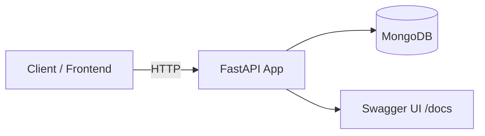

<h1 align="center">🗓️ Employee Attendance & Analytics API</h1>

<p align="center">
  <b>Track employee attendance, handle manual corrections, and get monthly analytics through a clean REST API.</b><br/>
  Built with FastAPI and MongoDB, with interactive API docs out of the box.
</p>

<p align="center">
  
  
  
  
  
</p>

<p align="center">
  <a href="#-run-locally">🚀 Run Locally</a> ·
  <a href="#-api-documentation">📖 API Docs</a> ·
  <a href="#-architecture">🏗️ Architecture</a>
</p>

<!-- TODO: add a screenshot of the /docs page (Swagger UI) -->


---

## 💡 The Problem

Managing attendance with spreadsheets leads to missing records, silent edits, and no
easy way to see patterns over time. This API gives HR and engineering teams a single
backend to **record attendance, correct mistakes, and analyze monthly trends**.

## ⚡ What It Does

- ✅ **Attendance tracking** for employees
- ✏️ **Manual corrections** when a record needs to be fixed
- 📊 **Monthly analytics** for attendance summaries
- 📖 **Interactive API documentation** (Swagger UI) generated automatically
- 🗂️ **Indexes created at startup**, so queries are ready without manual database setup

---

## 🏗️ Architecture



```text
Request → FastAPI route → validation → MongoDB (attendance / corrections) → JSON response
```

<!-- TODO: expand with your real layers (routers, services, models) if you have them -->

---

## 🛠️ Tech Stack

| Layer | Technologies |
|---|---|
| **Language** | Python 3.11+ |
| **Framework** | FastAPI, Uvicorn |
| **Database** | MongoDB 6.0+ |
| **Docs** | OpenAPI / Swagger UI (built into FastAPI) |

---

## 📖 API Documentation

Once the server is running, open the interactive docs:

```text
http://localhost:8000/docs
```

<!-- TODO: fill this table from your real routes (see /docs). Don't list routes you haven't built. -->
| Method | Endpoint | Description |
|---|---|---|
| POST | `/...` | Record attendance |
| PATCH | `/...` | Manual attendance correction |
| GET | `/...` | Monthly analytics |

---

## 🚀 Run Locally

**Prerequisites:** Python 3.11+, MongoDB 6.0+

### 1. Install dependencies

```bash
python -m pip install -r requirements.txt
```

### 2. Configure environment

Set these in your environment, or in a local `.env` file that is **not committed**:

```env
MONGO_URI=your_mongodb_connection_string
MONGO_DB=your_database_name
```

### 3. Start the server

```bash
uvicorn app.main:app --port 8000
```

- API: **http://localhost:8000**
- Interactive docs: **http://localhost:8000/docs**

The API creates its database indexes automatically at startup.

> ⚠️ Never commit `.env` files or database credentials.

---

## 📊 Example

<!-- TODO: paste a real request/response from your API -->
```http
GET /...?month=2026-10
```

```json
{
  "month": "2026-10",
  "present_days": 0,
  "absent_days": 0
}
```

---

## ⚠️ Known Limitations

<!-- TODO: edit to match reality -->
- Runs locally only; not yet deployed
- Automated test coverage not documented yet
- Authentication and role-based access are not described here

---

## 🛣️ Roadmap

- [ ] Automated tests and CI (GitHub Actions)
- [ ] Docker Compose for the API + MongoDB
- [ ] Authentication and role-based access
- [ ] Deployment with a live demo
- [ ] Export reports (CSV / PDF)

---

## 📄 License

No license has been specified yet. Add a `LICENSE` file (for example MIT) before distributing.

---

## 👨‍💻 Author

**Gautam Kumar Yadav** · Full-Stack & AI Engineer

[](https://github.com/Gautam0804)
[](https://www.linkedin.com/in/gautam-yadav-10922726b)
[](https://gautam-portfolio-self.vercel.app/)
[](mailto:gautamcodesin@gmail.com)

---

<p align="center"><i>Built with code, curiosity & chai ☕</i></p>
